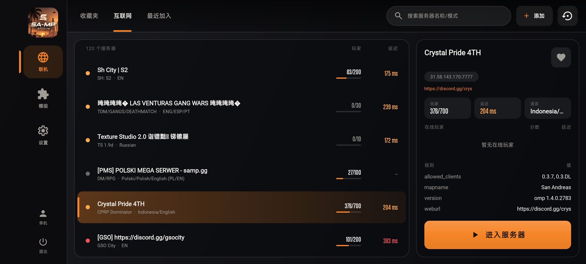
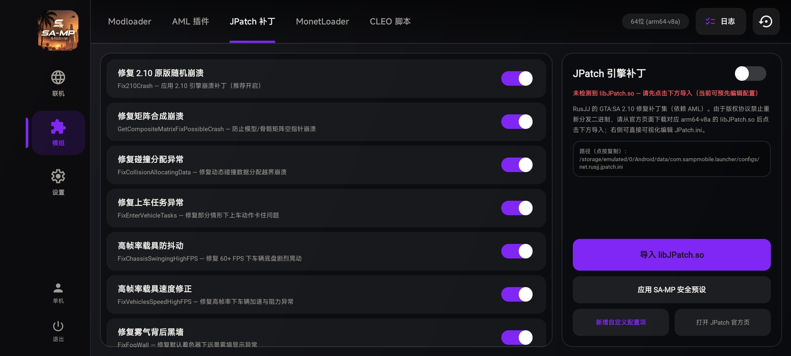
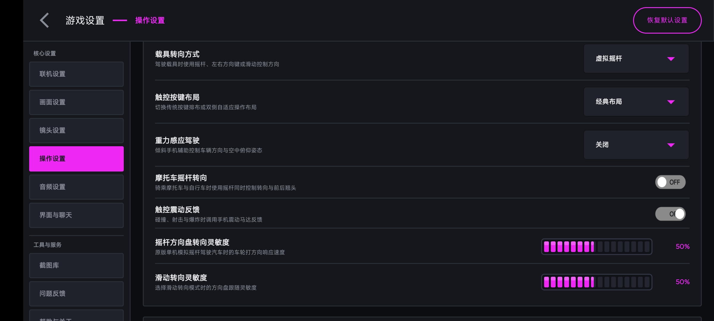
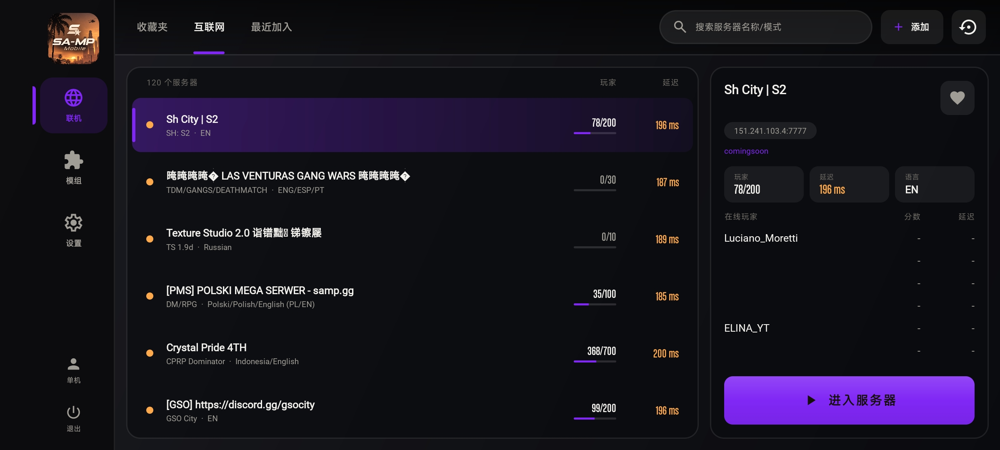

# SA-MP Mobile

A native Android SA-MP multiplayer client for **GTA: San Andreas Android v2.10** (Java launcher + C++ native library `libSAMPMOBILE.so`), with dual-architecture builds for `arm64-v8a` and `armeabi-v7a`.

> See [NOTICE](NOTICE) for copyright, third-party component, and compliance statements.



---

## Project Overview

This project continues to evolve from the open-source Alyn SA-MP Mobile architecture, targeting modern Android (up to **Android 14 / 15, SDK 35**). It includes a **complete launcher rewrite, a rebuilt native protocol and engine foundation, broad and deep behavior alignment with SA-MP / `open.mp`, five-in-one mod ecosystem coexistence, and end-to-end stability hardening**.

The client is designed to **strictly align with PC SA-MP / `open.mp` behavior, never breaking the multiplayer protocol or anti-cheat contract for the sake of mobile**: for anything involving core synchronization, combat resolution, vehicle state machines, blocking single-player leftovers, and server anti-cheat compatibility, the reference is the `open.mp` upstream source, official documentation, and disassembly of `libGTASA.so` (arm64 / arm32); mobile-side engineering adaptations are limited to touch interaction, Android window/process isolation, the high-resolution Chinese font atlas, and modern system security policies.

This project is maintained and updated irregularly, and stays fully open and transparent, with no hidden logic or private features. The repository contains no game assets or commercial fonts; runtime files must be extracted by users from their own game copies. You are welcome to build, modify, and fork freely; derivatives must be released under the same **GNU GPL v3.0** license. If you run into problems, please file an Issue.

---

## Required Resources

For copyright compliance, this repository provides only source code and open-source dependencies. Before building and running the client from scratch, prepare the following external resources:

| Resource | Description | Required? | Placement / Usage |
|---|---|---|---|
| **GTA:SA Android v2.10 installer** | Extracts `libGTASA.so`, `libImmEmulatorJ.so`, and lightweight APK assets (supports standard ~26 MB APKs, Split APKs, and 2 GB+ combined APKs; the script automatically skips large assets) | Required to build the APK | After installing on your phone, run `prepare_gtasa.py --from-adb`, or put the APK in `dist/` with a filename starting with `gtasa` (e.g. `gtasa_2.10_arm64.apk`) and run `prepare_gtasa.py` once (naming rules are in "Extracting GTA:SA v2.10 runtime files" below) |
| **GTA:SA Android v2.10 game data** | Provides ~2.4 GB of base single-player maps, models, animations, and textures (a regular ~26 MB APK does not include this data; pair it with `.obb` files; extract `.xapk`/`.apks` first) | Required to build the data package | Put the `main`/`patch` `.obb` files (or a 2 GB+ complete `.apk`) directly in the root `dist/` folder; the script auto-detects them in `main` → `patch` order |
| **PC GTA:SA + SA-MP 0.3.7** | Provides `SAMP.img`, `SAMP.ide`, `SAMPCOL.img`, and PC TextDraw textures (no third-party phone repack needed) | Required to build the data package | Pass your local install directory to `build_gamedata.py` via `--pc-samp` |
| **Open-source Chinese font** (e.g. Noto Sans SC) | Generates `SAMP/fonts/chinese.ttf` for Chinese text display | Optional (recommended for Chinese servers) | Put it in `dist/` named as a font file containing `font` (supports `.ttf` / `.ttc` / `.otf`); if omitted, it falls back to the bundled Roboto |

> **Notes on GTA:SA Android v2.10:**
> - Google Play has moved on to v2.11+, whose underlying memory layout is incompatible with this client — be sure to use **v2.10**.
> - `tools/engine/prepare_gtasa.py` automatically detects and strips the Fastman92 injection (`libFastman92pluginLoader.so`) found in common v2.10 patched packages, restoring the stock `JNI_OnLoad`/`JNI_OnUnload`.
> - These patched packages also move the program header table inside `libGTASA.so` to the end of the file. Real devices load it fine, but x86 emulators (e.g. LDPlayer) crash immediately when loading such a library, showing up as an instant crash on entering the game. The extraction script automatically moves it back to the standard location — no extra steps needed. The official stock `libGTASA.so` does not have this issue, and the script leaves it untouched.
> - **If your `libGTASA.so` was extracted before 2026-11-23** (when the script did not yet have this step), it will crash on emulators. Just run the extraction again and rebuild.
> - If the installer only contains 64-bit `arm64-v8a` (no 32-bit `armeabi-v7a`), modern 64-bit phones can still build and run it directly; the build check only warns and does not block.

---

## Build Environment

| Tool / Component | Version Required | Notes |
|---|---|---|
| **JDK** | **17 – 21** (JDK 21 recommended) | Gradle 8.13 does not support JDK 25+ (it fails with `major version 69`) |
| **Android SDK** | `compileSdk 35` / `targetSdk 35` / `minSdk 24` | Requires Platform 35 and Build-Tools 35 installed |
| **Android NDK** | **`25.1.8937393`** | Pinned in `app/build.gradle` |
| **CMake** | **`3.22.1`** (or a compatible version) | Installable via the Android Studio SDK Manager |
| **Gradle** | **8.13** (wrapper included in the repo) | No global install needed |
| **Python 3** | 3.10+ | Runs the `tools/` scripts; `build_gamedata.py` requires `numpy` |

---

## Build & Deploy Flow

### 1. Clone the repo and configure `local.properties`

```bash
git clone https://github.com/XiaoNiaoa/samp-mobile.git
cd samp-mobile
cp local.properties.example local.properties
```

Fill in your local Android SDK path in `local.properties` (opening the project in Android Studio generates it automatically):

```properties
# Windows
sdk.dir=C\:\\Users\\<YourUser>\\AppData\\Local\\Android\\Sdk

# macOS / Linux
# sdk.dir=/Users/<YourUser>/Library/Android/sdk
```

### 2. Extract the GTA:SA v2.10 runtime files

This step extracts the native libraries and lightweight assets from the GTA:SA v2.10 installer into the project (the target paths are already in `.gitignore`).

#### Easiest way

1. Put the GTA:SA v2.10 APK in the `dist/` folder at the repo root.
2. Rename the file so it starts with `gtasa` (rules below).
3. Run once from the repo root:

```bash
python tools/engine/prepare_gtasa.py
```

Whether `dist/` has one APK or several, **run it only this once** — do not run it once per APK.

#### APK naming rules

When run without arguments, the script finds APKs automatically using these rules:

| Rule | Description |
|---|---|
| Location | Must be directly under `dist/`; files in subfolders are not found |
| Extension | Must be `.apk` (extract the inner `.apk` from `.xapk` / `.apks` first) |
| Filename | Must start with `gtasa`, case-insensitive; anything may follow |
| Count | Unlimited; all matching APKs are processed in the same run |

Examples:

| Filename | Found? |
|---|---|
| `dist/gtasa_2.10.apk` | Yes |
| `dist/gtasa_2.10_arm64.apk`, `dist/gtasa_2.10_arm32.apk` | Yes, both processed together |
| `dist/GTASA-v2.10.apk` | Yes (case-insensitive) |
| `dist/GTA SA v2.10 64-bit.apk` | No (starts with `GTA SA`, with a space — not `gtasa`) |
| `dist/apk/gtasa_2.10.apk` | No (in a subfolder) |

Other files in `dist/` (`.obb`, `gamedata.zip`, fonts, etc.) are unaffected — the script does not touch them.

`arm64` / `arm32` in a filename is only for humans; the script does not judge the ABI from the filename — it opens the APK and checks which ABI's library is inside.

#### When there are two APKs (32-bit and 64-bit separate)

Some installers split 32-bit and 64-bit into two APKs. Put both in `dist/` named per the rules, then run the script once — both ABIs' libraries will be extracted.

- Multiple APKs are processed in alphabetical filename order.
- When the same library appears in multiple APKs, the first one found is used and later ones are skipped.
- Assets (`assets`) are merged: for same-named files, the later APK wins.
- A 64-bit-only APK is fine too; modern 64-bit phones are enough. The script will warn about the missing 32-bit library, which you can ignore.

#### Other extraction methods

```bash
# Specify APKs or a Split-APK directory manually (filenames are not bound by the rules above; list multiple APKs in one command)
python tools/engine/prepare_gtasa.py --apk dist/gtasa_2.10_arm32.apk dist/gtasa_2.10_arm64.apk

# GTA:SA v2.10 already installed on the phone (no single-player data package import needed); extract directly from the phone over ADB
python tools/engine/prepare_gtasa.py --from-adb

# Clean up locally extracted proprietary files (including the backups mentioned below)
python tools/engine/prepare_gtasa.py --clean
```

#### What the script does during extraction

1. Places `libGTASA.so` (and the 32-bit `libImmEmulatorJ.so`) in `app/src/main/jniLibs/<ABI>/`.
2. If `libGTASA.so` comes from a Fastman92-patched installer: removes its loader injection and moves the program header table back to the standard location (the latter so it can run on x86 emulators — see "Notes on GTA:SA Android v2.10" above).
3. Places the APK's lightweight assets in `app/src/main/assets/`. This step **clears** any previously extracted content in that directory first, then writes fresh.

Optional flag `--libs-only`: only does the first two steps and leaves `app/src/main/assets/` untouched. Use it when assets were already extracted and you only want to update the native libraries. It can be combined with any of the methods above:

```bash
python tools/engine/prepare_gtasa.py --libs-only
```

Other behavior:

- If an extracted library is identical to the one already in `jniLibs`, it is not rewritten; if different, the old file is first backed up to `build/gtasa-backup/<ABI>/`, then replaced.
- After extraction, rebuild the APK (next step) for it to take effect.

#### FAQ

- **Message `No APK given and no dist/gtasa*.apk found`**: there is no APK in `dist/` matching the naming rules — check the location, extension, and filename prefix against the table above.
- **Message `No lib/arm64-v8a/libGTASA.so or lib/armeabi-v7a/libGTASA.so found`**: this APK has no game library — usually the wrong file (e.g. just an installer shell, or a non-ABI split from a Split APK).
- **Message `WARNING: SHA-256 differs from verified v2.10`**: this library is not exactly the same as the verified official v2.10. Patched installers trigger this warning; it usually does not affect use — but if the game misbehaves, try a v2.10 installer from another source.
- **Instant crash on entering the game on an emulator**: `libGTASA.so` was extracted with an old version of the script. Run the extraction again, then rebuild.

### 3. Build the APK

Debug builds need no signing config or `google-services.json`; the output goes to `app/build/outputs/apk/debug/samp.apk`:

```powershell
# Windows (PowerShell) — if the default JDK is >= 25, point to JDK 17–21 first
# $env:JAVA_HOME = "C:\Path\To\jdk-21"
.\gradlew.bat assembleDebug
```

```cmd
:: Windows (CMD)
set JAVA_HOME=C:\Path\To\jdk-21
gradlew.bat assembleDebug
```

```bash
# macOS / Linux
./gradlew assembleDebug
```

> Add `-PskipGtasaCheck=true` only for a source/C++ dry-run compile check (without extracted GTA:SA files).
>
> - **Release signing (optional)**: configure `SAMP_STORE_FILE`, `SAMP_STORE_PASSWORD`, `SAMP_KEY_ALIAS`, and `SAMP_KEY_PASSWORD` in `local.properties` or environment variables, then run `./gradlew assembleRelease` (never commit key files).
> - **Firebase Crashlytics (optional)**: place `app/google-services.json` following `app/google-services.json.example` and it enables automatically; off by default.

### 4. Generate the data package (`.zip`) and import it in one tap in the launcher

1. Put the GTA:SA v2.10 `main`/`patch` `.obb` files (or a 2 GB+ complete `.apk`) in the repo-root `dist/` folder;
2. (Optional) Put a Chinese font (e.g. `font.ttf` / `font.ttc` / `font.otf`) in `dist/`;
3. Point to the PC GTA:SA directory with **SA-MP 0.3.7** installed, and run one command to auto-generate `dist/gamedata.zip`:

```bash
python tools/gamedata/build_gamedata.py --pc-samp "D:\Program Files (x86)\Rockstar Games\GTA San Andreas"
```

> Optional flags: `--gtasa` (specify the OBB/APK path manually), `--cjk-font` (specify the font manually), `--out` (default `dist/gamedata.zip`; pass a directory path to output loose files instead), `--keep-audio` (keep full audio), `--scm-dir` (replace scripts).

**One-tap import on the phone:**
1. Copy `dist/gamedata.zip` to any folder on the phone (e.g. `Download/`); no need to touch `Android/data/` manually;
2. Install and open `SA-MP Mobile`, then pick the file under **Settings → Multiplayer → One-tap .zip import** (or follow the popup prompt when joining a server);
3. The launcher streams and extracts it into its own `files/` directory, while keeping your existing `settings.json` and server list — fully avoiding Android 14 directory-permission and nesting issues.

### 5. Custom launcher background (optional)

Name a landscape image `launcher_backdrop.jpg` (`.png` / `.webp` also work), put it in `app/src/main/res/drawable-nodpi/`, and rebuild to replace the default gradient background; deleting the file restores the default.

- Recommended size **2400×1080** (20:9); other aspect ratios fill the screen with a center crop. The leftmost ~1/10 of the image is covered by the navigation bar, so keep the main subject out of there.
- The filename must be all lowercase, with only one copy (the same directory must not contain two extensions).
- A darkening scrim and a translucent panel sit on top of the image to keep text readable; adjust their opacity in `res/values/colors.xml` via `ui_backdrop_scrim` (scrim) and `ui_glass` (panel).

---

## Local Automated Checks & Tests

Without a real device or emulator, you can run 5 stages of objective checks and automated tests through the unified entry point `tests/check.py` (see [tests/README.md](tests/README.md)):

- **Dual-ABI compile-time layout guards**: `app/src/main/cpp/SAMPMOBILE/AbiGuards.cpp` validates pointer width, RakNet types, SA-MP sync packet sizes, and GTA:SA core engine struct layouts when building `arm64-v8a` / `armeabi-v7a`.
- **Unified check entry point (integrates NDK `llvm-nm`/`llvm-readelf` and Android SDK `aapt2`/`zipalign`/`apksigner`):**

  ```bash
  # Daily quick check (compliance, platform contracts, dual-ABI ELF / 537-symbol table / DT_NEEDED / real JNI exports, APK tool checks)
  python tests/check.py

  # Full check (adds C++ desktop unit tests, Gradle JVM unit tests, and the gamedata chunk round-trip)
  python tests/check.py --full

  # Pre-release strict gate (requires GTA:SA + APK, and adds the official Android Lint check)
  python tests/check.py --release
  ```

- **Run the C++ desktop unit tests alone** (WSL / Linux): `sh tests/native/run.sh` (covers protocol primitives, input arbitration, config contracts, and cross-checks against the `open.mp` upstream source).
- **Run the Gradle JVM unit tests alone**: `./gradlew testDebugUnitTest`

---

## UI Preview







---

## FAQ

- **`Unsupported class file major version 69` error**: your current `JAVA_HOME` is JDK 25+ — switch to JDK 17–21 and rebuild.
- **AML / MonetLoader fails to load on Android 14+**:keep `useLegacyPackaging = true` in `app/build.gradle` and `android:allowNativeHeapPointerTagging="false"`.
- **First Gradle dependency fetch is slow**: `settings.gradle` already configures a mirror fallback after the official source.

---

## License & Disclaimer

The project's original and modified code is released open source under the **GNU General Public License v3.0**; see [LICENSE](LICENSE) for the full text and [third_party/licenses/THIRD_PARTY_NOTICES.md](third_party/licenses/THIRD_PARTY_NOTICES.md) for the third-party component license list.

This project continues development on the open-source Alyn SA-MP Mobile architecture and keeps the original file attribution notices. It has no affiliation with Rockstar Games, Take-Two Interactive, or the official SA-MP team, and distributes no Rockstar proprietary binaries, game data packages, or commercial fonts — see [NOTICE](NOTICE) for details.
